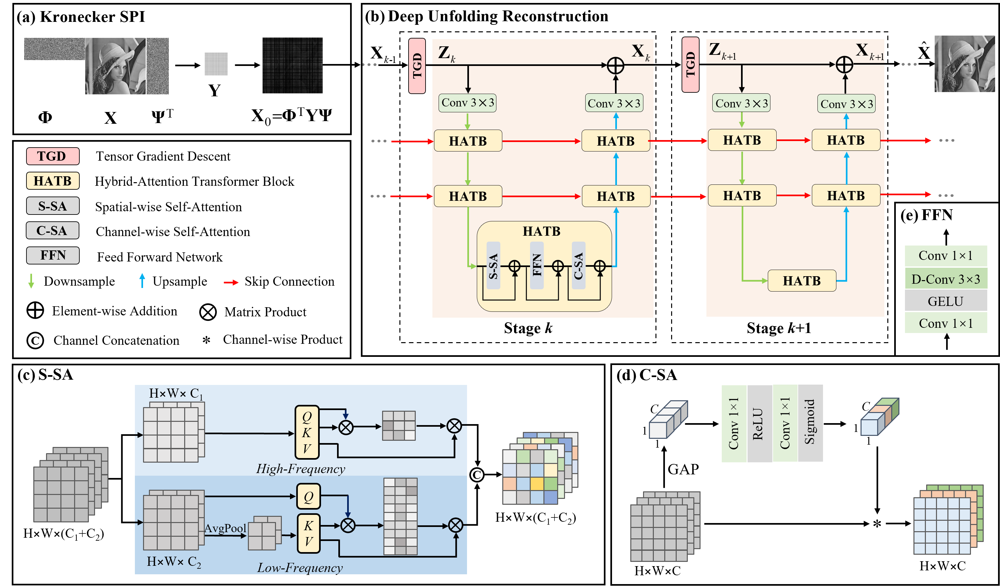

# HATNet-SPI (CVPR 2024)

Official PyTorch implementation of **Dual-Scale Transformer for Large-Scale Single-Pixel Imaging**.

Gang Qu, Ping Wang, and Xin Yuan.

[Paper](https://openaccess.thecvf.com/content/CVPR2024/html/Qu_Dual-Scale_Transformer_for_Large-Scale_Single-Pixel_Imaging_CVPR_2024_paper.html) | [PDF](https://openaccess.thecvf.com/content/CVPR2024/papers/Qu_Dual-Scale_Transformer_for_Large-Scale_Single-Pixel_Imaging_CVPR_2024_paper.pdf)

## Overview

HATNet is a deep unfolding network for large-scale single-pixel imaging. It combines a Kronecker sensing model with efficient tensor gradient descent and a hybrid-attention multi-scale denoiser. Dual-scale spatial attention captures image details at different scales, while channel attention recalibrates global features. The paper evaluates reconstruction quality on synthetic data and measurements from a real single-pixel imaging prototype.



## Installation

```bash
git clone https://github.com/Gang-Qu/HATNet-SPI.git
cd HATNet-SPI
conda create -n hatnet python=3.13.2 -y
conda activate hatnet
python -m pip install --upgrade pip
python -m pip install torch==2.6.0 torchvision==0.21.0 \
  --index-url https://download.pytorch.org/whl/cu126
python -m pip install numpy==2.1.3 scipy==1.15.1 \
  scikit-image==0.25.0 scikit-learn==1.6.1 \
  opencv-python-headless==4.11.0.86 einops==0.8.1 \
  albumentations==2.0.5
```

## Repository Structure

```text
HATNet-SPI/
  model/network.py    # HATNet architecture
  dataset/BSDS400/    # Training images
  dataset/Set11/      # Benchmark images
  Figs/              # Paper illustrations and results
  opts.py            # Model, dataset, and optimization settings
  train.py           # Training
  test.py            # Evaluation and reconstruction image export
  utils.py           # Data loading, metrics, and utilities
```

## Data Preparation

The repository includes BSDS400 training images and the Set11 benchmark under `dataset/`. To use other image directories, supply `--train_data_path` and `--benchmark_path`.

The data loaders use the Y channel of OpenCV's YCrCb conversion. Training augmentation includes random cropping, horizontal and vertical flipping, and resizing.

## Configuration

Configure the image dimensions, measurement dimensions, and architecture in `opts.py`. The defaults use `size=[256, 256]`, `meas_size=[181, 181]`, and seven unfolding stages, corresponding to approximately 50% sampling.


## Training

Run the following command from the repository root:

```bash
python train.py \
  --train_data_path ./dataset/BSDS400 \
  --benchmark_path ./dataset/Set11 \
  --device cuda
```


## Citation

```bibtex
@InProceedings{Qu_2024_CVPR,
  author    = {Qu, Gang and Wang, Ping and Yuan, Xin},
  title     = {Dual-Scale Transformer for Large-Scale Single-Pixel Imaging},
  booktitle = {Proceedings of the IEEE/CVF Conference on Computer Vision and Pattern Recognition (CVPR)},
  month     = {June},
  year      = {2024},
  pages     = {25327--25337}
}
```
